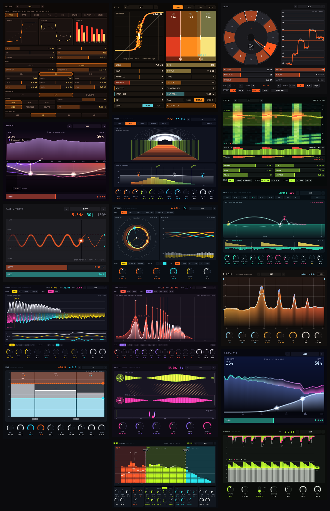

# Audio plugins

Free VST3 plugins written in Rust with [nih-plug](https://github.com/robbert-vdh/nih-plug) and egui.
Each plugin has its own crate under `plugins/`.

| Plugin | What it does |
|---|---|
| [`fake_vibrato`](plugins/fake_vibrato) | Adds vibrato with a modulated delay line. Drag a live pitch trace to set rate and depth. |
| [`aurora_air`](plugins/aurora_air) | Two-band high-frequency exciter. The interface is a live spectrum skyline with the added air as an aurora. |
| [`detent`](plugins/detent) | Automatic pitch correction: MPM pitch tracking, scale or MIDI targets, humanize, formant control, a low-latency Live mode and Learn Key. A pitch dial and scrolling tape show what it is doing. |
| [`kiln`](plugins/kiln) | Three-band saturator: four styles, 4x oversampling, asymmetry, program-dependent drive, gain match, plus a tube-console chain (series pentode and triode with density, input and output transformers, a parallel 12AX7 path with a frequency flag, air, calibration). The interface is the transfer curve itself, with the live audio riding on it. |
| [`rime`](plugins/rime) | Dynamic resonance suppressor: a spectral, per-bin cut with depth, sharpness, selectivity, attack/release, stereo link, focus range and delta. Resonances show as ice icicles hanging from an ember spectrum. |
| [`serpent`](plugins/serpent) | De-esser with level-independent detection, a detector that tracks the sibilance, a dynamic bell, shelf or wideband cut, lookahead, and trigger and delta listen modes. Sibilants scroll past as a waterfall with the removed energy glowing red-hot and a snake that follows the detector. |
| [`doppel`](plugins/doppel) | Automatic double tracking: a copy of the vocal on a drifting tape delay with wandering time and pitch, tape saturation and roll-off, and independent stereo drift. Two tape lanes are tied by threads whose slant is the live delay, and a ruler sets the time. Twenty-four factory presets. |
| [`firefly`](plugins/firefly) | Opto compressor: a two-stage photocell whose release depends on how hard and how long it has been worked, a frequency-weighted sidechain, Compress/Limit, a 4x oversampled tube output stage and parallel mix. The display hangs the gain reduction like icicles of light, the slow memory in magenta under the fast stage in lime, with the threshold as a drag handle. Twenty-four factory presets. |
| [`vice`](plugins/vice) | Three-band upward and downward compressor: LR4 crossovers, a floor that lifts quiet parts and a ceiling that pushes peaks down, depth, time, per-band gain and a phase-coherent dry mix. Two toothed jaws close on three live level bars; drag the jaws and the crossover dividers. Twenty-four factory presets. |
| [`vault`](plugins/vault) | Algorithmic reverb: five spaces (room, hall, plate, chamber, abyss), early reflections, a modulated 8-line feedback network with a three-band decay-rate EQ, a frequency shifter in the loop, freeze, ducking, pre-delay, cuts and width. The tail flies away down a vaulted tunnel of arches, low in orange, mids in lime, highs in cyan, and a graph of decay time against frequency has draggable handles. Twenty-two factory presets. |
| [`skip`](plugins/skip) | Character delay where the feedback loop is the instrument: every repeat passes through allpass diffusion, a granular pitch shifter, a low and a high cut and an antialiased tape saturator, so repeats darken, climb or fall and smear. Slewing, modulated delay time (wow and flutter), tempo sync, ping-pong and ducking. Repeats are stones skipping on a log-time pond, with the time and feedback as drag handles and a scrolling view of the real echoes beneath. Twenty-eight factory presets. |

## Screenshots



Rendered headlessly from the real editors, with each plugin's DSP running on a synthetic signal.
Regenerate them, and the montage above, with `scripts/screenshots.sh [plugin ...]`. The individual
shots are in `docs/screenshots/<plugin>.png`.

Each plugin has an `examples/screenshot.rs` that builds its DSP and params, feeds the DSP a signal,
and hands the editor's `ui::draw` to `crates/ui_preview`, which runs it in an `egui_kittest` harness
on a wgpu renderer (no window, no host), and `crates/ui_preview`'s `stitch` example packs the results into `all.png`. Parameter edits are ignored, so the knobs show the defaults.
To add one for a new plugin, make its `ui` and `dsp` modules `pub`, add `ui_preview` as a
dev-dependency and copy `plugins/rime/examples/screenshot.rs`.
| [`smolder`](plugins/smolder) | Distortion with eight waveshapers, optional 3-band split with a model and drive per band, LFO or envelope modulation, bias, low cut, tone, 1x to 8x oversampling and mix. Fifteen factory presets, user presets, and live transfer curve, waveform and harmonic views. |

## Build and install

```sh
scripts/install.sh              # build and install every plugin
scripts/install.sh detent       # just one
```

This bundles the plugins into `target/bundled/` and copies them to
`~/Library/Audio/Plug-Ins/VST3`, and plugins with factory presets get theirs written to
`~/Library/Audio/Presets/Clowd/<name>` as `.vstpreset` files. Restart your DAW afterwards: a re-scan only updates its plugin list,
and the DAW keeps the old binary loaded until it quits.

To build without installing: `cargo xtask bundle <plugin> --release`.
Plugin display names live in `bundler.toml`.

## CI and releases

`.github/workflows/ci.yml` runs on every push to `main` and every pull request. `scripts/affected.py`
works out which plugins the change touches (a plugin's own files, or a shared crate such as
`preset_kit` that it depends on; workspace-level files rebuild everything), and each one is tested,
bundled and signature-checked on macOS as its own job. The `ci` job is the single check to require.

To publish a release, push a version tag (`jj tag set v1.0.0 -r main && jj git push`, or
`git tag v1.0.0 && git push --tags`). `.github/workflows/release.yml` tests the workspace, bundles every
plugin, and creates a GitHub release with one zip per plugin, an all-in-one zip and `SHA256SUMS`.
The builds are for the runner's architecture (Apple silicon) and ad-hoc signed.

## Presets

Every plugin has factory presets in a `presets.rs`, built on the shared `crates/preset_kit`. A preset
lists only the parameters it changes from the defaults. The same table drives the `< preset >` picker
in each editor (it reads CUSTOM once you move anything) and the `.vstpreset` files that
`scripts/install.sh` writes for hosts like REAPER. To add presets to a plugin, copy `plugins/kiln`'s
`presets.rs`, `examples/write_presets.rs` and `Cargo.toml` changes, and call `preset_kit::ui::picker`
from the editor.

## Test

```sh
cargo test --release
```

Detent has the most tests. They run its pitch tracker, note logic and shifter on synthetic voices.
`DETENT_FILES=name cargo test -p detent --release offline -- --ignored --nocapture` runs it over
raw mono f32 recordings in `/tmp/detent`; see `plugins/detent/src/tests.rs`.

## Adding a plugin

1. Create `plugins/<name>/` with a `Cargo.toml` like the others (`crate-type = ["cdylib"]`, workspace
   dependencies on `nih_plug` and `nih_plug_egui`) and a `src/lib.rs`.
2. Add an entry to `bundler.toml`.
3. Pick a unique 16-byte `VST3_CLASS_ID`.

## Licence

The VST3 bindings that nih-plug uses are GPLv3, so these plugins are GPL-3.0-or-later.
