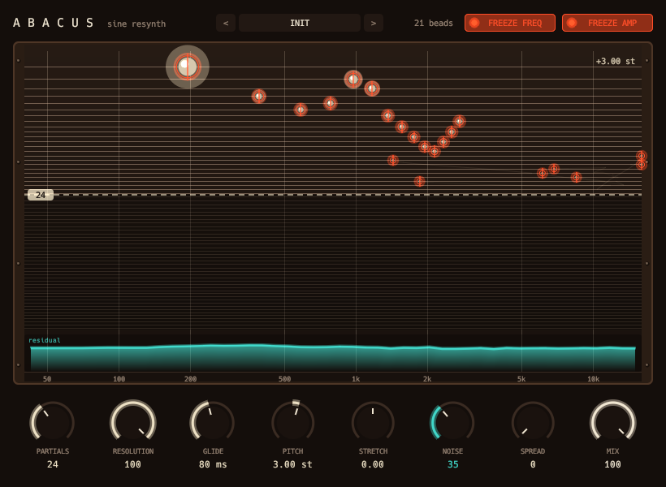

# Abacus



Sine-bank resynthesis, after GRM Tools Grinder.

- STFT peak tracking into up to 64 partials, each with a persistent identity.
- Rebuilt on phase-continuous oscillators.
- **Freeze Freq** and **Freeze Amp** hold each partial.
- Resolution, Glide, Pitch, Stretch and Spread.
- **Noise** adds back what the sines do not explain.
- 2560 samples of latency, reported.

## Display

- Each partial is a bead on a wire. Left to right is log frequency, and the strongest sit on the top wire.
- Size and brightness are level. Frozen beads are ringed in vermilion.
- Drag the board sideways to transpose. Drag the cut line to set the partial count.

Twenty-four factory presets.

```sh
scripts/install.sh abacus
```

See the [main README](../../README.md) for building, testing and the other plugins.
