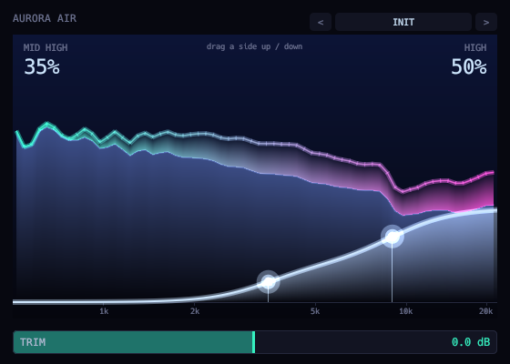

# Aurora Air



Two-band high-frequency exciter. The interface is a live spectrum skyline with the added air as an aurora.

```sh
scripts/install.sh aurora_air    # build and install the VST3
```

See the [main README](../../README.md) for building, testing and the other plugins.
