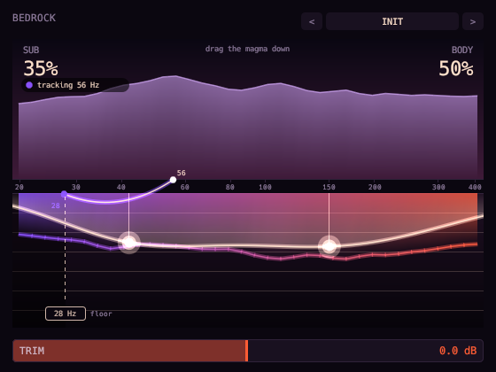

# Bedrock



Low-end exciter, the counterpart of [Aurora Air](../aurora_air). Aurora Air grows content above the
top of a signal; Bedrock grows content around the bottom of one. It adds, on top of the untouched
dry signal, two things made from the bass (30 to 130 Hz, mono):

- **Body** is harmonics of the bass, so it is heard on speakers that cannot reproduce it. The band is
  divided by its own envelope and fed through Chebyshev polynomials: `T2(sin t) = cos 2t` and
  `T3(sin t) = -sin 3t`, so a note gains its second and third harmonics and nothing else, in the
  same proportion at any level. A high-pass at 55 Hz keeps the fundamental and any difference
  tones out. Body is polyphonic: it works on a whole mix, and where several notes sound at once
  each gets its own harmonics (with the intermodulation any waveshaper makes).
- **Sub** is an octave below. A Schmitt trigger finds the rising zero crossings of the low band and a
  flip-flop divides them by two. That only means something while there is one note, so the engine
  fades in once three cycles in a row agree (within 7%, between 36 and 120 Hz) and out as soon as
  they stop: under a chord, a dense low end or noise it stands down. The square wave is filtered to
  a near sine and follows the band's envelope.
- **Floor** is a high-pass on the sub only: nothing is added below it, so no headroom is spent on
  frequencies a system cannot play.

No latency: both engines are filters and memoryless shapers, and the dry signal passes straight through.

The display is Aurora Air's night sky turned upside down. The dry spectrum is a mountain ridge above
the ground line. What the plugin adds hangs below it as magma, violet for the octave and vermilion
for the harmonics. The glowing line is the amount: drag the left half down for Sub and the right
half down for Body. While the sub is locked, a bridge arcs from the note it follows on the ridge to
the octave it adds. Drag the dashed Floor line to move the floor. Seventeen factory presets.

```sh
scripts/install.sh bedrock    # build and install the VST3
```

See the [main README](../../README.md) for building, testing and the other plugins.
