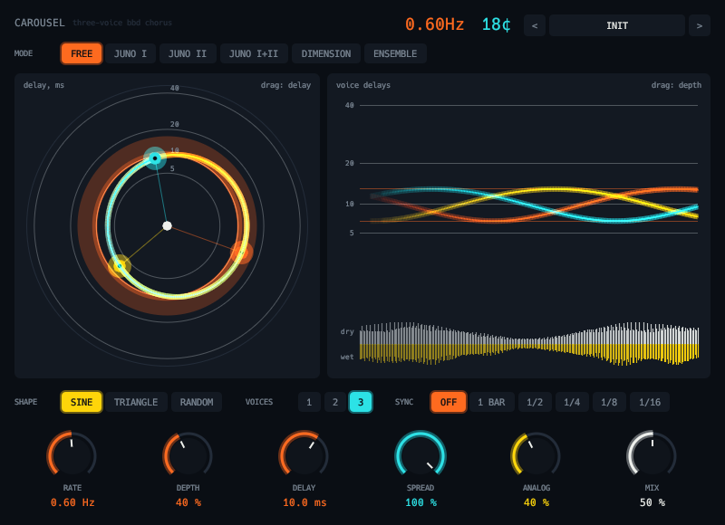

# Carousel



Three-voice chorus with analog (BBD) voicing. Juno I / II / I+II, Dimension and Ensemble modes fix the voicing the way the hardware does; Free mode gives you rate, depth, delay, one to three voices, sine, triangle or random LFOs and tempo sync. Analog adds the band-limiting, saturation and hiss of a bucket-brigade delay, and Spread places the voices in the stereo field. Each voice is a horse on a carousel: its angle is its LFO phase and its distance from the hub is its delay. Twenty factory presets.

```sh
scripts/install.sh carousel    # build and install the VST3
```

See the [main README](../../README.md) for building, testing and the other plugins.
