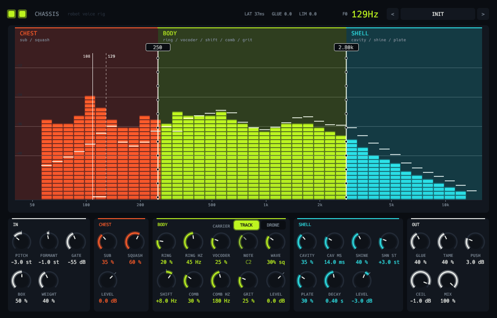

# Chassis



A robot-voice rig in one plugin: the chain you would otherwise build from three sends and a dozen
inserts.

```
in -> pitch + formant shift -> gate -> body EQ -> 3-way split
       chest (low):  sub-octave -> squash
       body  (mid):  ring mod / vocoder -> frequency shifter -> comb -> saturation
       shell (high): cavity delay -> granular shine -> plate
     -> sum -> glue -> notches -> push -> true-peak limiter -> mix
```

- **Pitch and formant** use pitch-synchronous overlap-add on a tracked pitch (the tracker and shifter
  are Detent's), so the voice drops by up to 8 semitones with its formants set separately: lower
  them with the pitch for a bigger chest, raise them for a smaller head.
- **Gate** watches the input but acts on the shifter's output, so its gain is applied
  the shifter's latency later: the gate opens before the first word arrives.
- **Body EQ** is a bell that cuts boxiness at 400 Hz only while there is something there, and a
  100 Hz low shelf for weight.
- **Split** is two Linkwitz-Riley 4th-order crossovers (24 dB per octave) that sum back flat.
- **Chest**: a sub-octave from a flip-flop on the low band's fundamental, enveloped by the band,
  into an 8:1 compressor.
- **Body**: a ring modulator, a 16-band vocoder (carrier: two detuned band-limited oscillators from
  saw to square, at the voice's own shifted pitch or a drone note, with noise where there is no
  voice), a single-sideband frequency shifter (the phasing between it and the dry signal is the
  robotic cancelling), a feedback comb and a tape-ish saturator with first-order antiderivative
  antialiasing.
- **Shell**: a short modulated delay with no feedback, a granular shifter layered on top, and a four-line
  metal plate.
- **Master**: a 4:1 glue compressor with a program-dependent release, three narrow cuts at 2.5, 4
  and 6 kHz, and a lookahead limiter that measures peaks the way a true-peak meter does (4x
  oversampled), so the ceiling holds between the samples too.

The latency (the shifter's grains plus the limiter's lookahead, shown in the header) is reported to
the host, and the dry path of Mix is delayed to match. Mono and stereo.

The display is the spectrum as vent-grille slats, three bays wide: lit segments are the output and a
white tick on each column is the input. Drag the bulkheads between the bays to move the splits. The
dashed needle is the voice's pitch going in, the solid one is what comes out, and in Drone mode a
lime diamond marks the carrier. The eyes light with the output and shut when the gate closes. Fifteen
factory presets.

```sh
scripts/install.sh chassis    # build and install the VST3
```

See the [main README](../../README.md) for building, testing and the other plugins.
