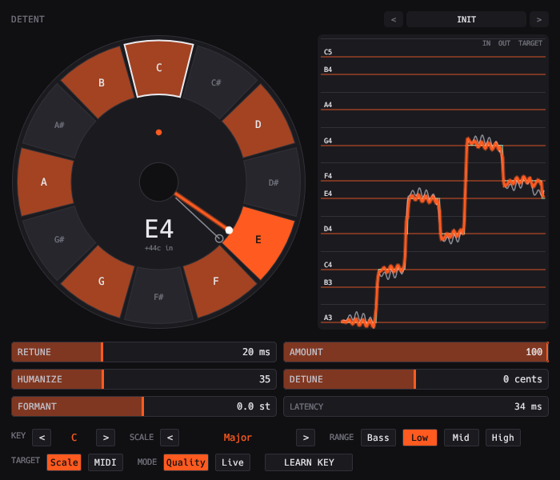

# Detent



Automatic pitch correction: MPM pitch tracking, scale or MIDI targets, humanize, formant control, a low-latency Live mode and Learn Key. A pitch dial and scrolling tape show what it is doing.

```sh
scripts/install.sh detent    # build and install the VST3
```

See the [main README](../../README.md) for building, testing and the other plugins.
