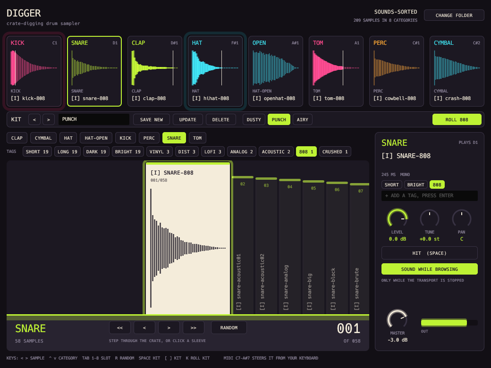

# Digger



Crate-digging drum sampler.

- Point it at a folder: each sub-folder (`kick`, `snare`, `hat`, ...) becomes a category, and every WAV is decoded into memory so swapping a sample while the groove plays is instant.
- Eight slots on the General MIDI drum notes (kick 36, snare 38, clap 39, hat 42, open hat 46, tom 45, perc 37, cymbal 49), with the usual neighbouring notes folded in. The closed hat chokes the open one.
- Level, tune and pan per slot, and a master level.
- Folder and selections are saved with the project by name, and the last folder is remembered for new instances.

## Tags

Every sample is tagged automatically, and you can add your own.

- **From file names:** a word that recurs (`808`, `acoustic`, `vinyl`, `lofi`) becomes a tag. Trailing numbers, years and the drum's own name are ignored.
- **From the audio:** within each category, the quickest-dying third is `short` and the slowest `long`; the lowest zero-crossing rate is `dark` and the highest `bright`.
- **By hand:** type a word into the box on the right and press Enter. Your tags show an `x` to remove them.

Click a tag above the crate to filter by it. Stepping, random picks and kit rolls then only use samples carrying it; the rest stay in the crate, greyed back. Click it again to clear.

## Kits

A kit is the sample chosen in every slot.

- **SAVE NEW** stores what the slots hold now. Click a saved kit, or use `<` `>`, to switch the whole set at once; **UPDATE** overwrites the selected kit and **DELETE** removes it. Type in the name box to rename.
- **ROLL KIT** gives every slot a random sample from its own category, drawn from the active tag if there is one (`ROLL 808`). A rolled kit is a mix until you save it.
- Switching or rolling a kit sounds a kick, snare and hat together (when browsing sound is on and the transport is stopped).
- Kits hold which samples are chosen, not level, tune or pan.

Tags you add and kits you save live in a `.digger.json` file inside the sample folder, so they go with the samples and are shared by every project that uses the folder.

## Browsing

| | Editor key | MIDI note |
|---|---|---|
| Sample back / forward | `<` `>` (shift: 10 at a time) | C7 + 2 / C7 + 3 |
| Random sample | `R` | C7 + 4 |
| Category up / down | `^` `v` | C7 + 5 / C7 + 6 |
| Slot back / forward | `Shift+Tab` `Tab`, or `1`-`8` | C7 / C#7 |
| Sound the slot | `Space` | G7 |
| Kit back / forward | `[` `]` | G#7 / A7 |
| Roll a kit | `K` | A#7 |

Everything is on screen too: step and random buttons on the crate, category and tag tabs, the kit strip, clickable slot cards and sleeves, and drag or scroll on the crate. The editor keys need the plugin window to have keyboard focus. The MIDI notes work from anywhere: play them from Reaper's virtual MIDI keyboard or a controller while the project runs. The notes C7-A#7 never collide with a drum.

"Sound while browsing" plays each new sample as you land on it, but only while the host transport is stopped, so it never sits on top of the groove. Click a card, a sleeve, or drag and scroll the crate with the mouse.

## Display

- Eight slot cards, each with the sample's waveform, a playhead and a flash on every hit. Pink for lows, lime for snaps, cyan for metal, orange for the rest.
- A record crate for the slot in focus: samples stand as sleeves with their names on the spines, and the chosen one is pulled up and opened out to show its waveform.

```sh
scripts/install.sh digger
```

See the [main README](../../README.md) for building, testing and the other plugins.
