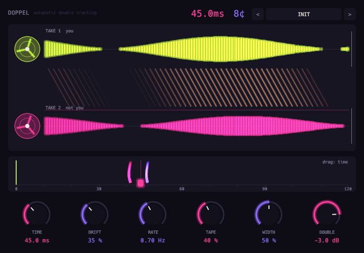

# Doppel



Automatic double tracking.

- A copy of the vocal on a drifting tape delay.
- Wandering time and pitch.
- Tape saturation and roll-off.
- Independent stereo drift.

## Display

- Two tape lanes, tied by threads whose slant is the live delay.
- Drag the ruler to set the time.

Twenty-four factory presets.

```sh
scripts/install.sh doppel
```

See the [main README](../../README.md) for building, testing and the other plugins.
