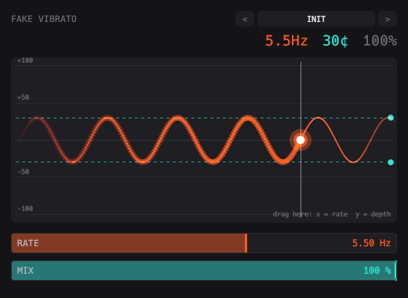

# Fake Vibrato



Adds vibrato with a modulated delay line. Drag a live pitch trace to set rate and depth.

```sh
scripts/install.sh fake_vibrato    # build and install the VST3
```

See the [main README](../../README.md) for building, testing and the other plugins.
