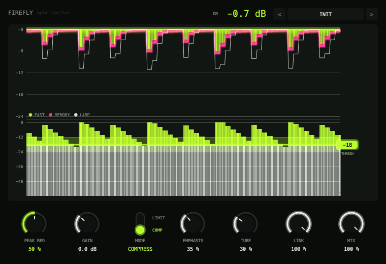

# Firefly



Opto compressor: a two-stage photocell whose release depends on how hard and how long it has been worked, a frequency-weighted sidechain, Compress/Limit, a 4x oversampled tube output stage and parallel mix. The display hangs the gain reduction like icicles of light, the slow memory in magenta under the fast stage in lime, with the threshold as a drag handle. Twenty-four factory presets.

```sh
scripts/install.sh firefly    # build and install the VST3
```

See the [main README](../../README.md) for building, testing and the other plugins.
