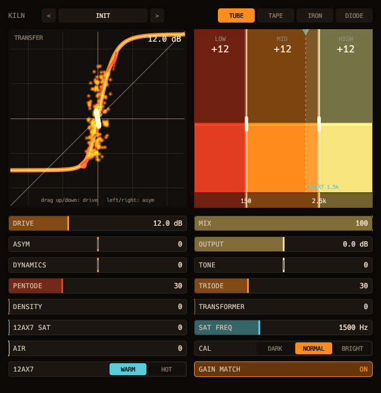

# Kiln



Three-band saturator.

- Four styles, 4x oversampling, asymmetry, program-dependent drive and gain match.
- A tube-console chain: series pentode and triode, input and output transformers, a parallel 12AX7 path, air and calibration.

## Display

- The transfer curve itself, with the live audio riding on it.

```sh
scripts/install.sh kiln
```

See the [main README](../../README.md) for building, testing and the other plugins.
