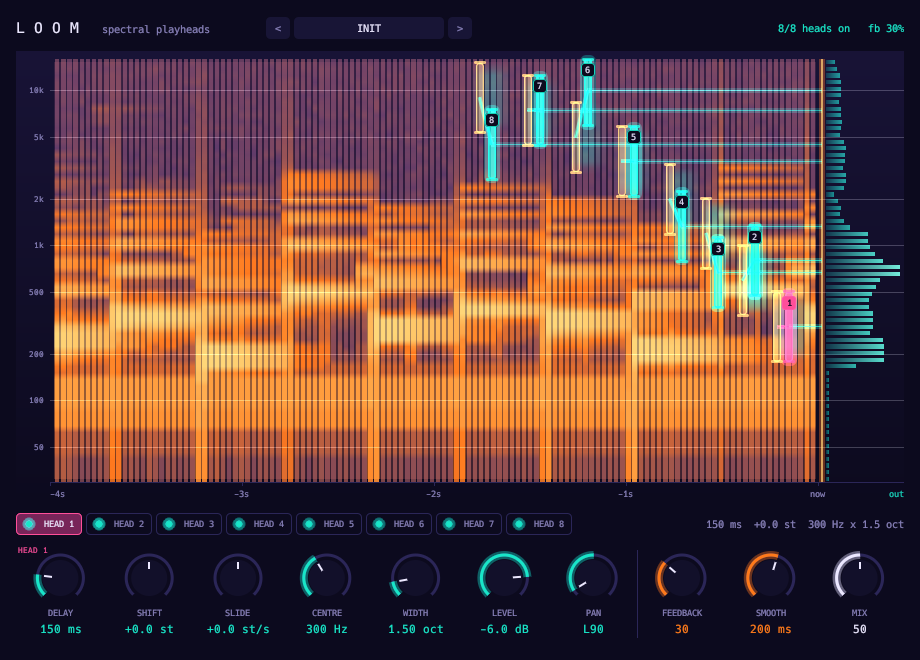

# Loom



Spectral playheads, after GRM Tools Fusion.

- A four-second spectrogram history, read by up to eight heads.
- Each head has its own delay, pitch shift, glide, band-pass window, level and pan.
- Bounded feedback into the history.
- 2048 samples of latency, reported.

## Display

- The spectrogram is the orange cloth of a loom. Every head is a heddle you drag across it.
- Teal slat: drag for delay (across) and pitch (up and down, shift for fine).
- Hollow slat: drag to move the band. Drag either end to set its width.
- The finished cloth, the live output spectrum, hangs off the right edge.

Twenty-one factory presets.

```sh
scripts/install.sh loom
```

See the [main README](../../README.md) for building, testing and the other plugins.
