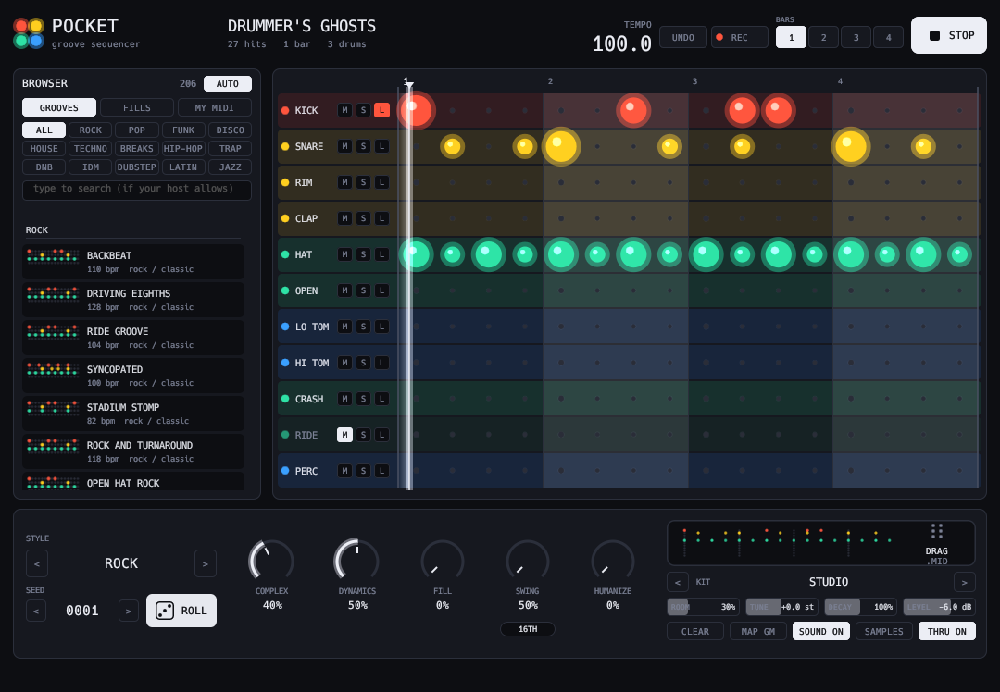

# Pocket



Drum groove sequencer and browser, after MT Power Drum Kit 2's groove browser and Augmatic GRE's generator.

- About 240 hand-written grooves and fills in folders: rock, pop, funk, disco, house, techno, breaks,
  hip-hop, trap, drum & bass, breakcore and IDM, dubstep, footwork, Latin, reggae, jazz and shuffle.
  Drag one out of the plugin and drop it on a track in your DAW.
- Fills that go onto the end of whatever is on the board: snare, tom, kick and snare, breakbeat,
  electronic builds, metal.
- Add your own folders of `.mid` files (MY MIDI). They are read in place, mapped onto the eleven
  drums by General MIDI note, and appear in the same browser, search and drag-out.
- Patterns up to four bars, including odd lengths.
- A seeded generator in 12 styles: complexity, dynamics, fill, swing, humanize. The same seed always rolls the same groove.
- Plays the groove as MIDI out on channel 10, locked to the host transport. General MIDI or eleven pads from C1.
- Built-in drums you can actually audition with, in seven kits: Studio, Rock, Jazz and Tight (modal
  models of real drums, with velocity-dependent timbre, per-hit variation and a room), Electro 808,
  Lo-Fi, and My Samples (your own WAV files). Room, tune and decay controls. It also answers
  incoming MIDI notes.
- Eleven drums, one or two bars of sixteenths, per-peg velocity, timing nudge and rolls.

## Display

- Every drum is a row of holes. A hit is a peg: its size is the velocity, its position the timing.
- A comb sweeps the board. Each peg it strikes pops a marble in that drum's colour, thrown higher the harder the hit.
- Red kick, yellow snares and claps, mint hats and cymbals, blue toms and percussion.

## Browser

- Three tabs: GROOVES, FILLS and MY MIDI. Grooves and fills are each one long scrolling list, with a
  label where the genre changes. No folders to open.
- A row of genre chips filters the list (ROCK, HIP-HOP, DNB, IDM ...). Pick a genre and its sub-genres
  appear as tag chips (ROCK: CLASSIC, HALF-TIME, PUNK, METAL) to narrow it further with the mouse.
  Each row also shows its tags under the name.
- Search covers every groove, fill and file at once, by name, genre or sub-genre. Typing needs the
  host to pass keys to the plugin; REAPER keeps most of them for its own shortcuts unless the FX
  window is set to send all keyboard input to the plug-in. The chips work without a keyboard.
- Click a groove to load it (locked drums stay). Click a fill to put it on the end of the pattern.
  With AUTO on, picking one starts it playing if nothing else is running.
- Drag any row out of the plugin to take it as a clip.
- MY MIDI follows the folders you add (+ ADD A FOLDER). Notes that are not drums are ignored, and
  clips longer than four bars are cut there.

## Use

- Click a hole for a peg, drag across holes to paint.
- Drag a peg up or down for velocity. Shift-drag for its timing. Mouse wheel nudges velocity.
- Right-click a peg to cycle its roll (x1 to x4). Right-drag to erase.
- M mutes, S solos, L locks a drum so rolling the generator or loading a groove leaves it alone.
- Drag a drum's name to take just that drum as a clip.
- Drag the clip chip (bottom right) to take the whole pattern, with swing and humanize baked in. Click it to save a `.mid` into `~/Music/Clowd Pocket` instead.
- PLAY (or space) runs the groove on the plugin's own clock while the host is stopped.

## Playing it from a keyboard

- **Drum keys:** the notes of the note map (MAP GM: kick 36, snare 38, closed hat 42 ...). They sound
  the built-in kit.
- **REC** (or key 97): while the groove runs, the drum keys are written into the pattern. Each note
  goes to the nearest step, follows the swing, and keeps its timing as a nudge and its velocity. UNDO
  (or key 100) puts back what was there before the take. A note played while nothing is running is
  not recorded.
- **Thru:** other notes you play (and the drum keys) are passed on to the next plugin.
- **Control keys** in the top octave (MIDI note numbers, middle C = 60): 96 play/stop, 97 record,
  98 roll a new groove, 99 a fill on the end, 100 undo the take. They are not passed on.
- **Mute keys** 84 to 94: one per drum, in the order of the board (kick first), each toggling that
  drum's mute.

## Kits

- The four acoustic kits are modal synthesis, not samples: snare and tom heads ring at a membrane's
  inharmonic modes, cymbals are dozens of plate modes, the snare wires are filtered noise that wakes
  more the harder you hit, and every hit varies a little so repeats are not machine-identical.
- **My Samples** loads a folder of your own `.wav` files (SAMPLES button). Each file is filed under a
  drum by its name or its folder's (`kick`, `snare`, `hat`, `hat open`, `tom low`, `crash` ...).
  Several files for one drum become velocity layers, quietest to loudest. Drums with no file fall
  back to the Studio kit. The folder is remembered with the project.
- `cargo run -p pocket --example audition --release -- out.wav` renders a groove through a kit to a
  WAV (`POCKET_GROOVE`, `POCKET_KIT`, `POCKET_ROOM`) to hear it without a DAW.

## In a DAW

Put Pocket on an instrument track. Route its MIDI to a drum sampler, or turn SOUND off. Or drop the
clips onto a MIDI track of your own and keep the plugin as a browser.

The clip is a standard MIDI file, so any host that takes a dropped `.mid` accepts it. The drag
starts a native macOS file drag; if a host refuses it, Pocket falls back to saving the file.

```sh
scripts/install.sh pocket
```

See the [main README](../../README.md) for building, testing and the other plugins.
