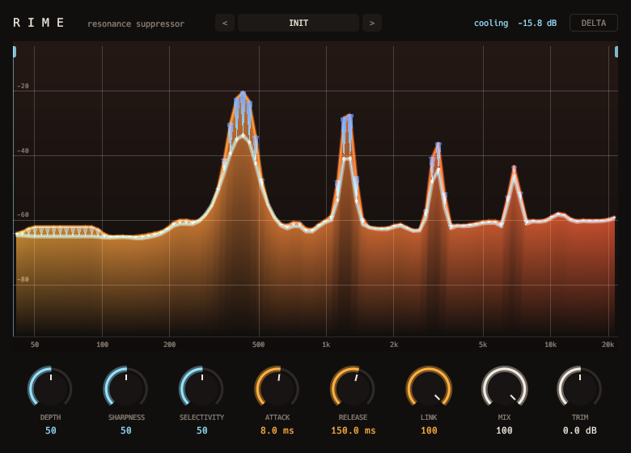

# Rime



Dynamic resonance suppressor.

- A spectral, per-bin cut.
- Depth, sharpness, selectivity, attack and release.
- Stereo link, focus range and delta.

## Display

- An ember spectrum. Each suppressed resonance hangs from it as an icicle.

```sh
scripts/install.sh rime
```

See the [main README](../../README.md) for building, testing and the other plugins.
