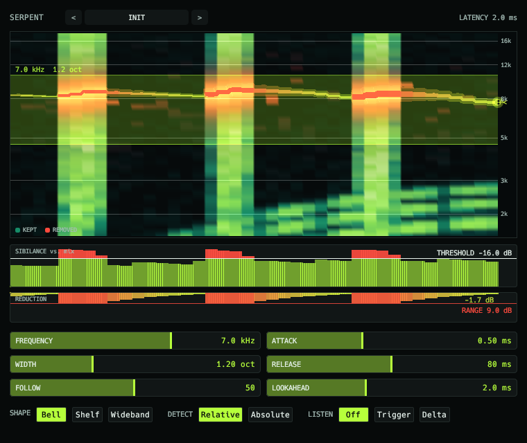

# Serpent



De-esser.

- Level-independent detection, with a detector that tracks the sibilance.
- Dynamic bell, shelf or wideband cut.
- Lookahead, plus trigger and delta listen modes.

## Display

- Sibilants scroll past as a waterfall, and the removed energy glows red-hot.
- A snake follows the detector.

```sh
scripts/install.sh serpent
```

See the [main README](../../README.md) for building, testing and the other plugins.
