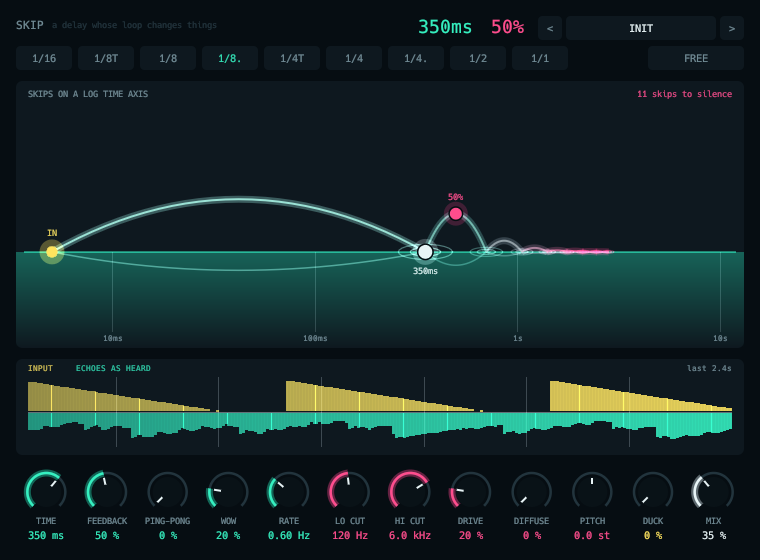

# Skip



Character delay where the feedback loop is the instrument.

- Every repeat passes through allpass diffusion, a granular pitch shifter, low and high cuts and an antialiased tape saturator.
- Repeats darken, climb, fall and smear.
- Slewing, wow and flutter, tempo sync, ping-pong and ducking.

## Display

- Repeats are stones skipping across a log-time pond.
- Time and feedback are drag handles. The real echoes scroll beneath.

Twenty-eight factory presets.

```sh
scripts/install.sh skip
```

See the [main README](../../README.md) for building, testing and the other plugins.
