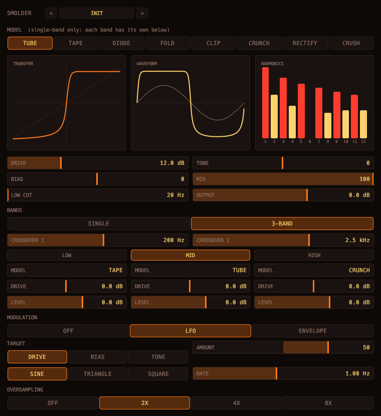

# Smolder



Distortion.

- Eight waveshapers: tube, tape, diode, fold, clip, crunch, rectify, crush.
- Bias, pre-shaper low cut, tilt tone, 1x to 8x oversampling and mix.
- 3-band mode (Linkwitz-Riley) gives each band its own model, drive and level.
- An LFO or envelope follower can modulate drive, bias or tone.

## Display

- The transfer curve, the test-sine waveform and the first twelve harmonics (odd in red, even in gold).
- All three are drawn from the same shaper the audio uses.

Fifteen factory presets.

```sh
scripts/install.sh smolder
```

See the [main README](../../README.md) for building, testing and the other plugins.
