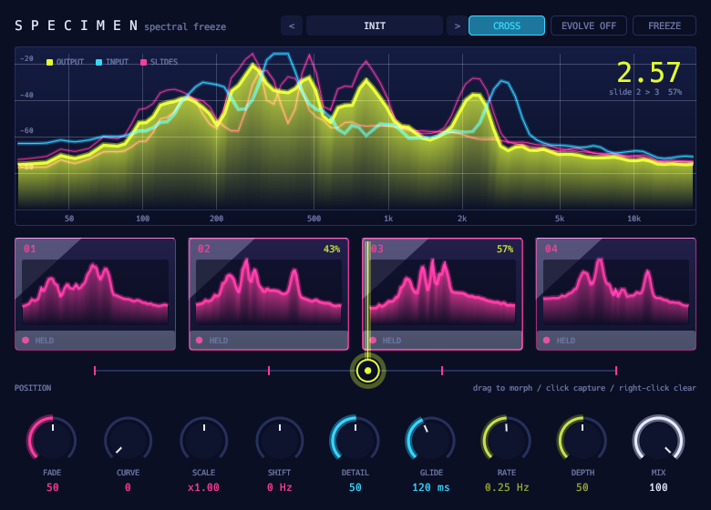

# Specimen



Spectral freeze and morph, an open answer to GRM Tools Evolution.

- Four snapshot slots, captured from the input.
- **Position** morphs between slots in log magnitude. **Curve**, **Scale** and **Shift** shape it.
- **Cross** imposes the snapshot's envelope on the live input.
- **Resynth** plays the frozen spectrum back with phase-vocoder phase advance.
- **Freeze**, **Evolve** (LFO or random walk), **Glide** and mix.
- Latency of one FFT length, reported.

## Display

- Four glass microscope slides, each holding a pink silhouette of its captured spectrum.
- Click a slide to capture into it. Right-click to clear.
- Drag along the rack to move the lens.
- The acid-yellow output morphs between slides, over the cyan live input.

Twenty-two factory presets.

Captured slides live in memory only. They are not saved with the project.

```sh
scripts/install.sh specimen
```

See the [main README](../../README.md) for building, testing and the other plugins.
