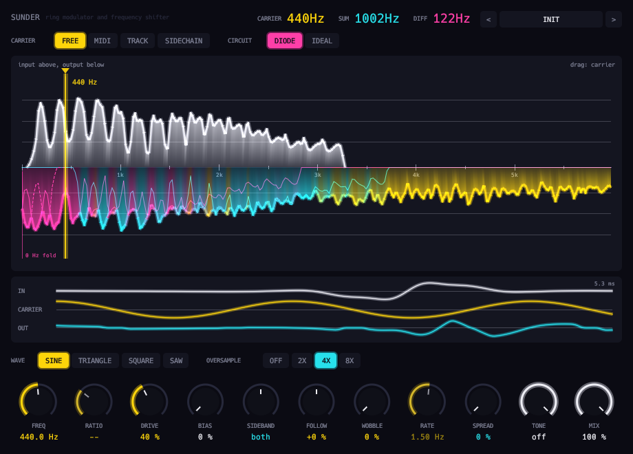

# Sunder



Ring modulator and frequency shifter.

- **Circuit.** `Diode` is Julian Parker's four-diode ring (DAFx-11). `Ideal` is a clean multiplier.
- **Carrier.** Free, MIDI, Track (the input's own pitch) or Sidechain. Sine, triangle, square or saw.
- **Sideband.** Slides from ring modulation to single-sideband shifting, up or down.
- **Bias** gives amplitude modulation. **Spread** offsets the right channel's carrier.
- 1x to 8x oversampling, with latency reported.

## Display

- The spectrum, split at the carrier. Drag the yellow blade to move it.
- The input rises above the line and the output hangs below.
- Sum sidebands are cyan and differences are magenta, folding off 0 Hz when they must.
- Yellow is anything the sums and differences cannot explain.
- A scope below shows the input, the carrier and their product.

Twenty-eight factory presets.

The MIDI carrier needs a host that sends MIDI to effects. The sidechain carrier needs one that routes a sidechain.

```sh
scripts/install.sh sunder
```

See the [main README](../../README.md) for building, testing and the other plugins.
