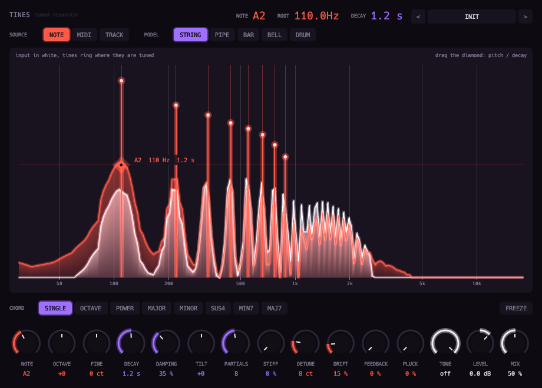

# Tines



Tuned resonator.

- Up to 64 modal resonators, so a voice, a loop or a pad rings like an instrument body.
- **Model**: String, Pipe, Bar, Bell or Drum.
- **Pitch**: the Note knob, held MIDI keys (latched on release), or the input's own pitch. Chords add up to four notes.
- **Decay** and **Damping**: upper modes die first.
- **Detune** widens the stereo. **Drift** wanders each note.
- **Feedback** sustains and self-oscillates. **Pluck** rings the upper modes on every onset. **Freeze** holds the ring.
- No latency.

## Display

- A comb of tuning-fork tines on a log-frequency spectrum.
- Each tine rises with the amplitude its resonator really rings at: coral for the root, violet for the chord.
- Drag the diamond sideways to retune (shift to slide) and up and down to set the decay.

Twenty-three factory presets.

The MIDI source needs a host that sends MIDI to effects.

Three presets are starting points for a deep, metallic voice: `Hayden`, `Hayden Tracking` and `Hayden Cathedral`.

```sh
scripts/install.sh tines
```

See the [main README](../../README.md) for building, testing and the other plugins.
