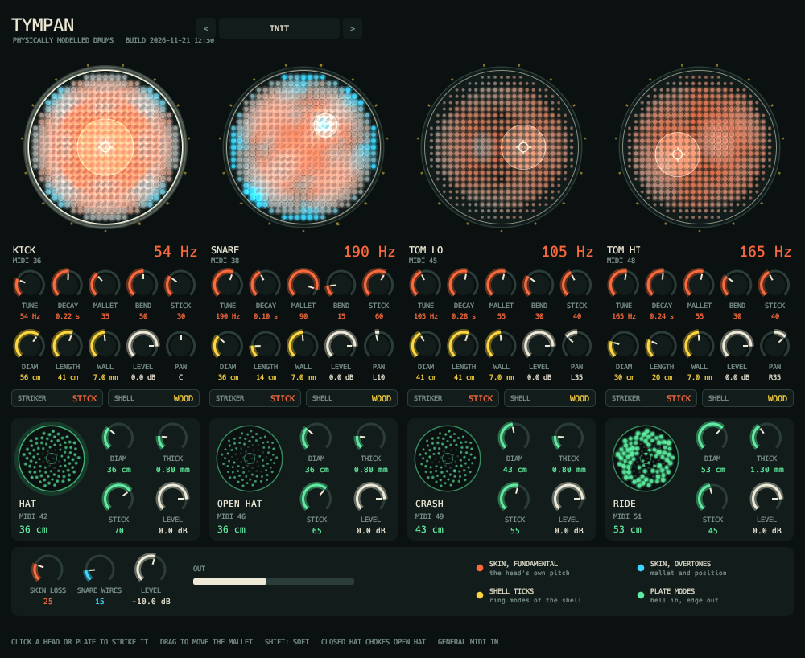

# Tympan

Physically modelled drum kit: four drums and four hats and cymbals played from MIDI, with no samples. Inspired by
[PDrum](https://github.com/dsp-ark/pdrum), which models a drumhead and a shell the same way.

## How it sounds

Each drum is a chain of the things that make a real one sound the way it does, from the stick to
the room. `PHYSICS.md` has the reasoning and the papers; in short:

- **The stick** is a mass that collides with the head through a Hertzian contact law with hysteresis (Hunt-Crossley), so the contact time falls out of the hardness and the speed: a few milliseconds for a stick, shorter and brighter for a harder or faster hit. **Mallet** sets the hardness. The **Striker** selector changes what is hitting: Stick, felt Beater, Felt mallet or Hand, each with its own mass, contact width and ring.
- **The whack** comes from the contact: a drum is struck at a speed that depends on the drum (a kick far harder than a snare), the head bends in pitch the harder it is driven, and the energy a collision loses becomes broadband impact noise, bright for a hard tip and dull for felt.
- **The stick's wood** rings as a free-free beam (modes at 1, 2.76, 5.40, 8.93 times the lowest), excited by the contact force: the tick of wood on a head. **Stick** is its level.
- **The head** is the 2D wave equation solved on a 25 x 25 grid with a circular rim, one finite-difference step per sample. Its overtones are the Bessel-function modes of a real membrane (1, 1.59, 2.14, 2.30 ... times the fundamental), not harmonics. Where you hit it picks the modes. **Bend** is tension modulation, the pitch drop of a kick.
- **The second head and the air** between the heads are coupled through the enclosed air, a spring whose stiffness comes from the drum's **Length** (a shorter drum is stiffer), which splits the head's symmetric modes into a pair: a lower with the heads moving together, a higher where they breathe in and out.
- **The shell** is a thin cylinder set by its **Diameter**, **Length** and **Wall** thickness and its material (the **Shell** selector: Wood, Metal, Composite, or None for a frame drum). Its modes come from shell theory, not tables, and it is tied to the head's rim both ways. Wood loses its modes quickly and steel rings.
- **Snare wires** are noise that follows how hard the drums are shaking them.
- **Hats and cymbals** are bronze plates built from their geometry: **Diameter**, **Thickness**, a bow, and for crash and ride a bell. Modes follow Chladni's law (clusters: tonal at the bottom, noise above), so a hat is bright noise, a crash a dense wash and a ride tuned with a ping; the ride bell (MIDI 53) strikes the bell. A hi-hat is two plates, and the closed one damps both. They stiffen slightly while struck, which gives a slow wobble.

The master level defaults to −10 dB so a groove, where the voices land together, has headroom: a limiter that is linear below 0.75 only catches rare pile-ups. (An earlier `tanh` distorted every groove by 15 to 24 dB while single hits stayed clean, so MIDI playing sounded worse than clicking the editor.)

The sound is deliberately dry: the drums sit in a dead space with no room, so add reverb afterwards.

Retriggering a ringing head just adds a new strike to the skin as it is, like hitting a real one.

## MIDI

| Drum | Notes |
| --- | --- |
| Kick | 35, 36 |
| Snare | 37, 38, 39, 40 |
| Low tom | 41, 43, 45 |
| High tom | 47, 48, 50 |

| Hat (closed) | 42, 44 |
| Open hat | 46 |
| Crash | 49, 52, 55, 57 |
| Ride | 51, 53, 59 |

Velocity sets the strength and the stick or mallet's hardness. Pocket's lanes all land somewhere (its perc lane, 56, is the one exception), so it plays the whole kit.

## The display

Each dot is one cell of the head's simulation, sized by how fast the skin is moving there. Coral is the fundamental, cyan is overtones, so a fresh hit flashes cyan and settles to coral as the overtones die. The eight yellow ticks around the rim are the shell's resonances. Each plate is a spiral of its modes, lowest at the bell and highest at the edge, lit by how loud each is ringing.

Click a head to strike it; the mallet point stays where you leave it, and the circle around it is how much skin the mallet touches. Shift-click for a soft hit. The knobs work like hardware: drag vertically, shift for fine, double-click to reset.

The display shows the real simulation (envelopes of each cell's displacement and velocity, written by the audio thread), not an animation.

## Parameters

Per drum: tune (30-600 Hz), decay, mallet, bend, click, shell level, level, pan and the mallet position. Per plate: diameter, thickness, stick and level. Global: shell size, shell ring, skin loss, snare wires and level. Factory kits: Acoustic (the default, fitted to recordings, see below), Arena, Tight Jazz, Taiko Hall, Biscuit Tin.

## Tests

`cargo test --release -p tympan` checks the physics on synthetic signals: the membrane's pitch and Bessel-function overtones, position dependence, decay, tension modulation, stability; the mallet's contact time against published ranges and the Hertz velocity law; the two-head split against the air-spring formula and its dependence on length; the shell's scaling laws and coupling both ways; and each striker and shell material moving the sound the way it should. `PHYSICS.md` lists what is simulated and what is still a stand-in.

## Body

The shell, the air between the heads and the resonant head are the drum's own reverberation, and they are loud enough to be heard: a kick rings for about half a second, toms a little longer, a snare a couple of hundred milliseconds before the wires and its short body let go. Saved plug-in state overrides new defaults, so after a voicing change remove the plug-in and add it again (or load the INIT preset).

A host resets the plug-in whenever the transport starts. Resetting used to blank each drum's membrane without retuning it, so MIDI after pressing play was untuned and tonal, while a click in the editor (which changes the strike position and so forces a retune) sounded right. The reset now keeps the tuning, and a test pins it.
