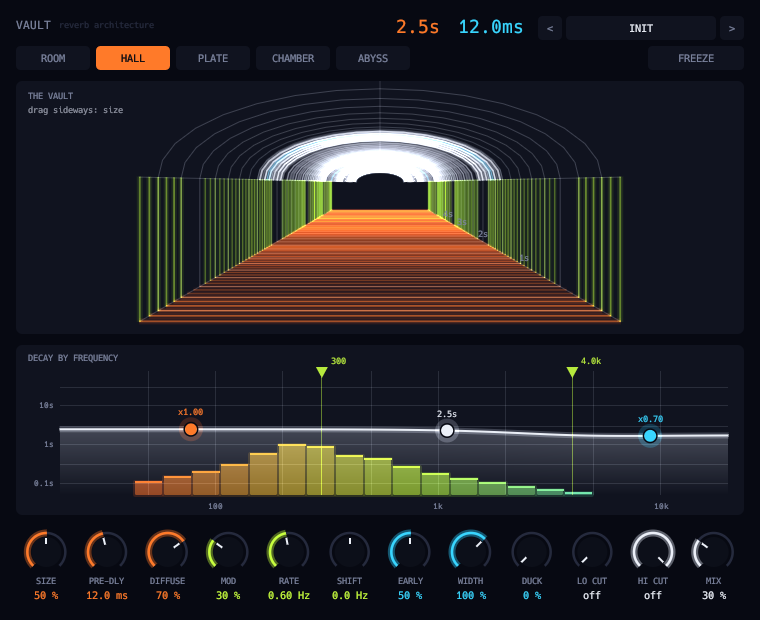

# Vault



Algorithmic reverb: five spaces (room, hall, plate, chamber, abyss), early reflections, a modulated 8-line feedback network with a three-band decay-rate EQ, a frequency shifter in the loop, freeze, ducking, pre-delay, cuts and width. The tail flies away down a vaulted tunnel of arches, low in orange, mids in lime, highs in cyan, and a graph of decay time against frequency has draggable handles. Twenty-two factory presets.

```sh
scripts/install.sh vault    # build and install the VST3
```

See the [main README](../../README.md) for building, testing and the other plugins.
