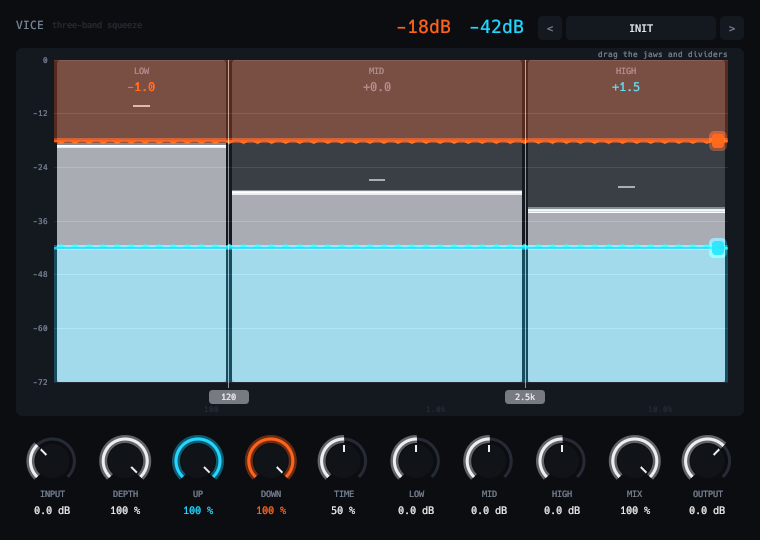

# Vice



Three-band upward and downward compressor.

- LR4 crossovers.
- A floor lifts quiet parts. A ceiling pushes peaks down.
- Depth, time and gain per band.
- Phase-coherent dry mix.

## Display

- Two toothed jaws close on three live level bars.
- Drag the jaws and the crossover dividers.

Twenty-four factory presets.

```sh
scripts/install.sh vice
```

See the [main README](../../README.md) for building, testing and the other plugins.
